# W'eau Mini Inverter pool heat pump — local control with ESPHome

Cloud-free control of the **W'eau Mini Inverter pool heat pump** (tested on **WMIP-003**, same controller family as WMI-003 / WMI-004) from Home Assistant, by flashing **ESPHome onto the original Tuya Wi-Fi module**. No extra hardware stays in the unit, and no Tuya account or cloud is involved.

  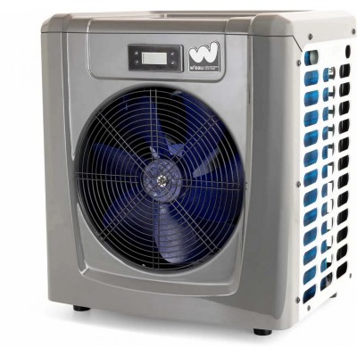
  &nbsp;&nbsp;
  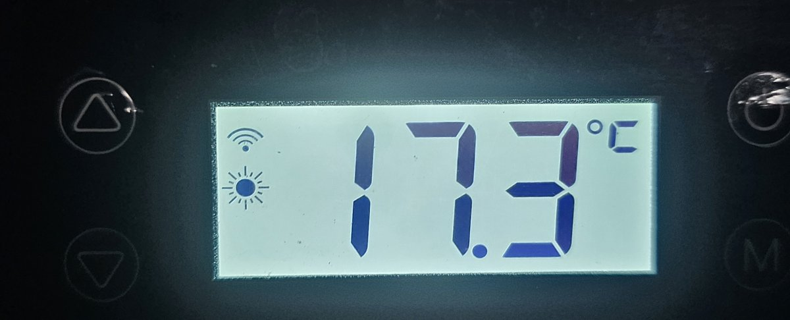

## What you get in Home Assistant

| Entity | Type | Notes |
|---|---|---|
| Heat pump | `climate` | Off / Heat / Cool, target temperature (1 °C steps), current water temperature (0.1 °C) |
| Water temperature | `sensor` | Inlet water temperature |
| Mode | `text_sensor` | Heating / Cooling, follows the **M** button on the display as well |
| Fault | `text_sensor` | Human-readable error codes, e.g. `E03 water flow failure` |
| Fault active | `binary_sensor` | `problem` device class, handy for notifications |
| Max / Min settable temperature | `sensor` (diagnostic) | 40/15 °C in heat mode, 28/8 °C in cool mode |
| Compressor (DP101), DP104, Fault bits | diagnostic | Raw values, see [Datapoints](#datapoints) |

Everything the Wi-Fi module can reach is exposed: the complete Tuya datapoint range was scanned (see below).

## Hardware

The unit consists of a **controller / display (CC1150A)** behind the front panel, a **Wi-Fi daughterboard (CC1150B)** plugged onto the controller with a 5-pin header, and an **inverter driver board** for the compressor and DC fan.

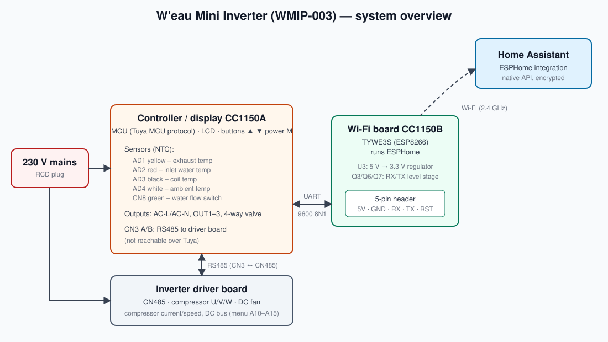

| | |
|---|---|
| 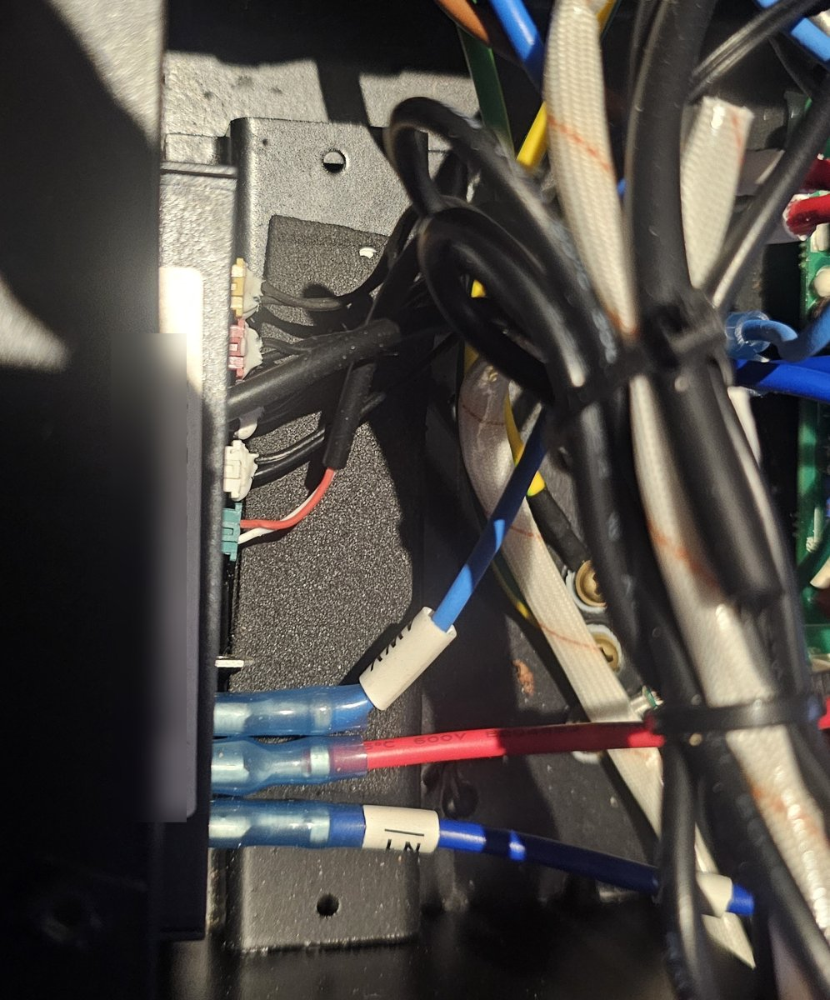 | 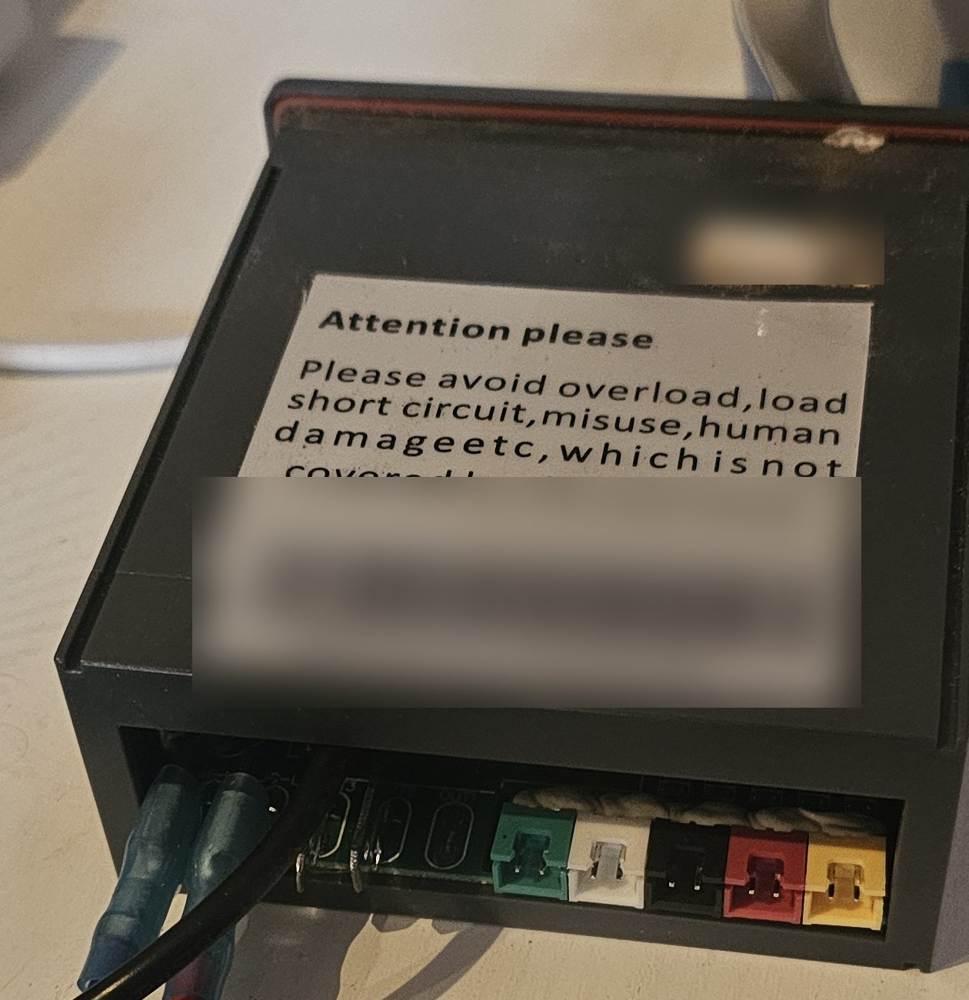 |
| *Controller location in the cabinet (side view)* | *Controller box, rear: mains, sensor connectors (green, white, black, red, yellow)* |
| 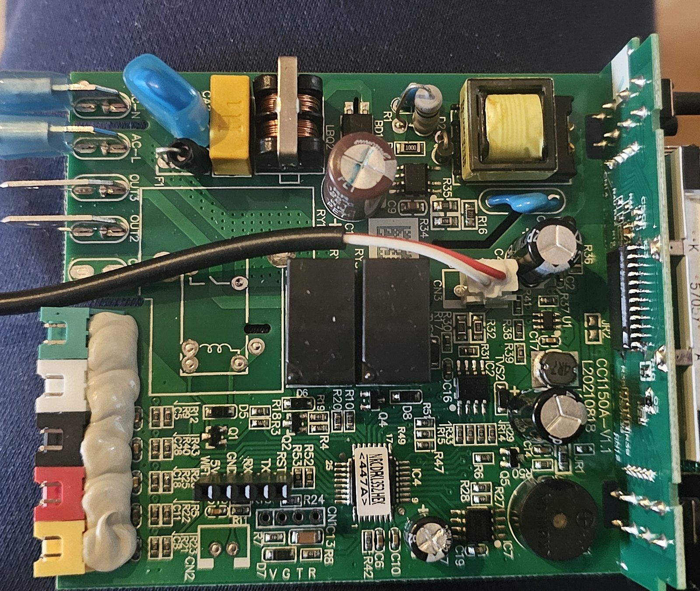 | 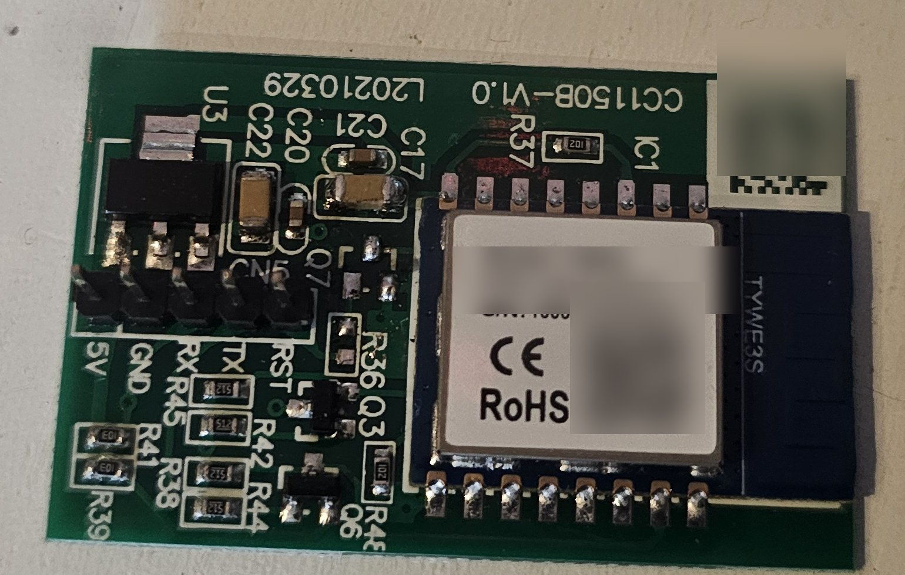 |
| *Controller PCB CC1150A with the 5-pin Wi-Fi header (5V · GND · RX · TX · RST)* | *Wi-Fi board CC1150B with the TYWE3S (ESP8266) module* |
| 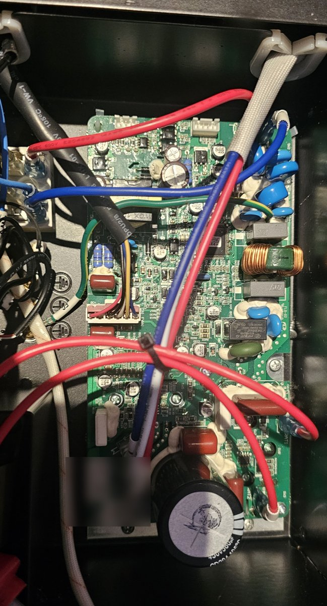 | 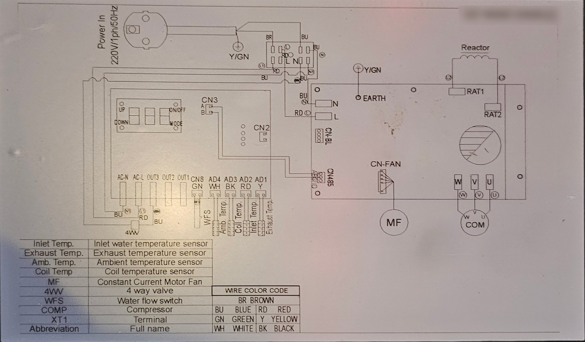 |
| *Inverter driver board (CN485 ↔ controller CN3)* | *Wiring diagram from the inside of the cover* |

Rating plate (WMIP-003)

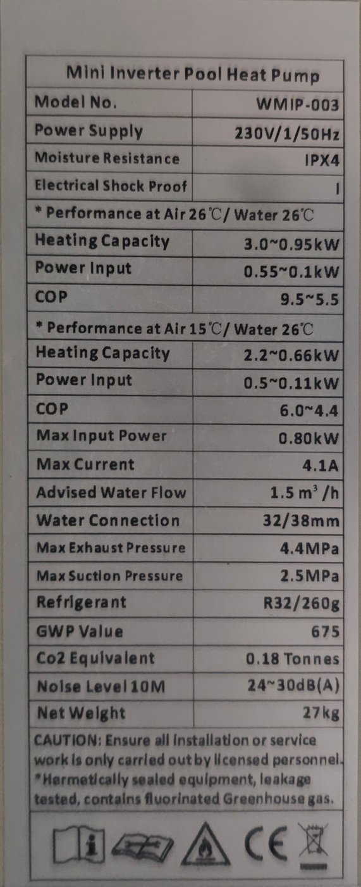

**Key facts**

- Wi-Fi module: **Tuya TYWE3S** = ESP8266 with 1 MB+ flash → ESPHome runs on it directly.
- Link to the controller: **Tuya MCU serial protocol, 9600 baud 8N1** on the module's UART0 (GPIO1/GPIO3).
- The CC1150B board has its own 5 V → 3.3 V regulator (U3) and a small transistor stage (Q3/Q6/Q7) between the header and the module.

## Datapoints

Product id `zqwet1zcvj2wcxzw`. On start-up the controller reports 9 datapoints. To make sure nothing hidden was missed, **every datapoint 3–255 was written with all five Tuya data types** (bool, enum, value, string, raw — about 1,900 writes). The controller only acknowledges writes to DP1, DP2 and DP9; everything else is silently ignored.

| DP | Type | Access | Meaning |
|---|---|---|---|
| 1 | bool | read/write | Power on/off |
| 2 | enum | read/write | Mode: **1 = heat, 4 = cool** (0/2/3 rejected — there is no auto mode) |
| 9 | value | read/write | Target temperature of the **active** mode (heat and cool each remember their own) |
| 10 | value | read | Inlet water temperature × 0.1 °C |
| 20 | bitmap | read | Fault bits, bit *n* = error **E(n+1)** (value 4 = E03) |
| 101 | value | read | Presumably compressor output — 0 while the compressor is off *(to be confirmed while running)* |
| 102 | value | read | Maximum settable temperature of the active mode (40 heat / 28 cool) |
| 103 | value | read | Minimum settable temperature of the active mode (15 heat / 8 cool) |
| 104 | bool | read only | Unknown, always on so far *(to be confirmed while running)* |

Notes

- ESPHome's `tuya` climate only **reads** the mode datapoint (`active_state`). The config writes DP2 itself in `on_control`, so Heat/Cool from Home Assistant works.
- The **display key lock** (hold ▲ + ▼) lives entirely in the display: it sends no frames and cannot be controlled over Wi-Fi.
- The service menu values **A01–A15** (outlet/ambient/exhaust/coil temperature, compressor current and speed, DC bus voltage, fan speed) and the **P01–P16** parameters are **not** available on the Tuya link. Part of them travels over the RS485 link between controller and driver board.

## Error codes

From the W'eau manual. The `Fault` sensor shows these as text.

| Code | Description | Typical cause |
|---|---|---|
| E03 | Water flow failure | Filter pump off, too little flow, loose flow-switch wiring |
| E04 | Freezing protection | Low ambient temperature |
| E09 | Communication failure | Controller ↔ PCB wiring / board |
| E10 | Communication failure | Controller ↔ driver board wiring / board |
| E12 | High exhaust temperature protection | Insufficient refrigerant |
| E15 | Inlet temperature sensor failure | Sensor open / short |
| E16 | Piping temperature sensor failure | Sensor open / short |
| E18 | Exhaust temperature sensor failure | Sensor open / short |
| E20 | Inverter module failure | Protection of the system |
| E21 | Ambient temperature sensor failure | Sensor open / short |
| E23 | Outlet water too cold (cooling) | Insufficient water flow |
| E27 | Outlet temperature sensor failure | Sensor open / short |
| E32 | Outlet water too hot (heating) | Insufficient water flow |
| E46 | DC fan motor failure | Wiring / fan motor *(cannot be shown via the 32-bit fault map)* |

## Flashing guide

> ⚠️ **Mains voltage inside.** Unplug the heat pump before opening the cabinet. Opening the unit may void your warranty. You do this at your own risk.

**You need**

- USB-TTL adapter with **3.3 V logic** (CP2102, CH340, FTDI …) — its +5 V pin powers the board
- 5 female-to-female Dupont jumper wires — **no soldering needed**, everything goes onto the existing header pins
- A browser with Web Serial (Chrome or Edge) for [web.esphome.io](https://web.esphome.io), or the ESPHome Builder
- Optional: a multimeter to verify the pads

**Steps**

1. **Build the firmware.** Add [`esphome/weau-mini-inverter.yaml`](esphome/weau-mini-inverter.yaml) to your ESPHome Builder, fill in the secrets (see [`secrets.example.yaml`](esphome/secrets.example.yaml)) and choose *Install → Manual download → Firmware image*.
2. **Remove the Wi-Fi board.** Unplug the unit, take out the controller and pull the small CC1150B board off its 5-pin header.
3. **Wire the adapter** to the header of the Wi-Fi board: +5V → 5V, GND → GND, TXD → RX, RXD → TX.

   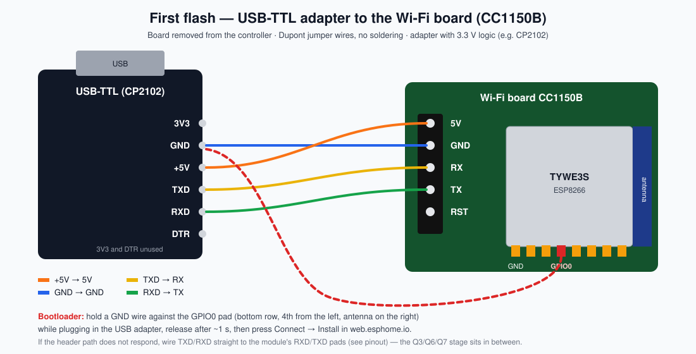

4. **Enter the bootloader.** Hold the end of a spare Dupont wire connected to GND against the **GPIO0** pad of the TYWE3S (bottom row, 4th from the left, antenna on the right) while plugging in the USB adapter. Release after about one second.

   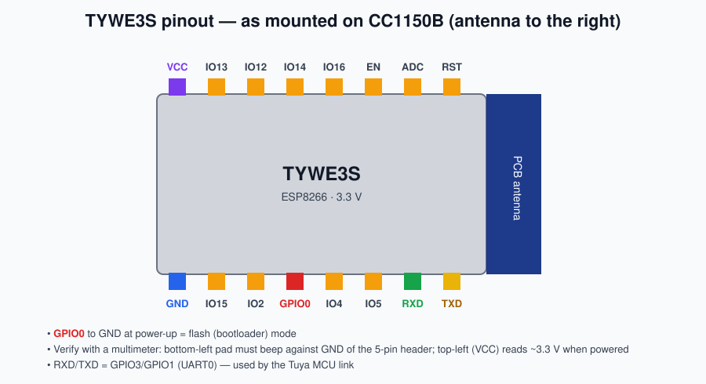

   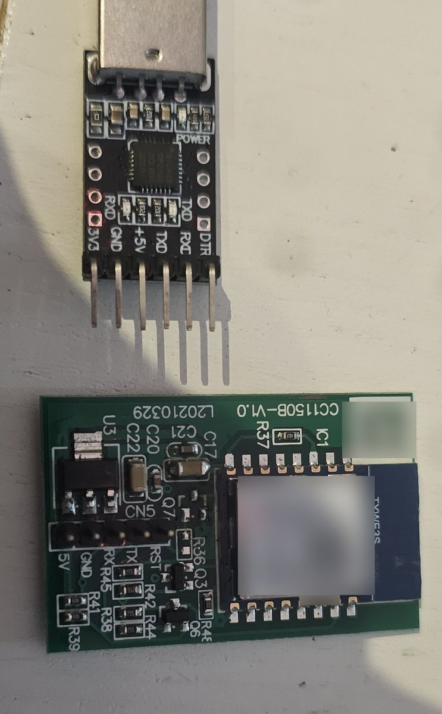

5. **Flash.** In web.esphome.io choose *Connect*, select the adapter, then *Install* and pick the downloaded `.bin`. A successful run shows `Chip is ESP8266EX` and `Wrote … bytes`.
6. **Reassemble.** Plug the Wi-Fi board back onto the controller, close the unit and power it up. The module joins your Wi-Fi; add it in Home Assistant via the ESPHome integration. All later updates go over Wi-Fi (OTA, encrypted).

**Troubleshooting**

- *web.esphome.io says "Connected" but flashing fails with "Failed to connect / serial noise"* — "Connected" only means the USB port is open. Check that the module is powered (≈3.3 V between the top-left VCC pad and the bottom-left GND pad) and that GPIO0 was low at power-up.
- *RXD LED on the adapter is lit permanently* — the RX line is held low: usually the module has no power.
- *Header path doesn't respond at all* (not needed on the tested unit) — connect the adapter's TXD/RXD directly to the module's RXD/TXD pads to bypass the Q3/Q6/Q7 stage.
- *`tuya: Initialization failed at init_state 0` in the log* — the controller did not answer (yet). Normal while the board is on your desk; once back in the unit it should list all datapoints within seconds after boot.
- *Want to keep the Tuya firmware?* Make a backup first: `esptool --port COMx read-flash 0 ALL backup.bin` (bootloader mode). Without a backup you cannot go back to the Tuya app.

## Home Assistant extras

- [`examples/home-assistant-winter-mode.yaml`](examples/home-assistant-winter-mode.yaml) — a *winter mode* for pumps that are unplugged over winter: hide the thermostat while stored, automatically leave winter mode and get a notification as soon as the pump comes back online, and a reminder if it goes offline without winter mode.

## Open points

- Confirm the meaning of **DP101** and **DP104** with the compressor running (needs water flow).
- Reading the RS485 link (A10–A15 values) would need additional hardware and is out of scope.

## License

[MIT](LICENSE). Not affiliated with W'eau or Tuya. Product names are used for identification only.
